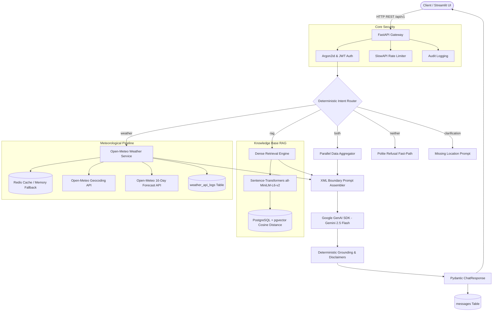
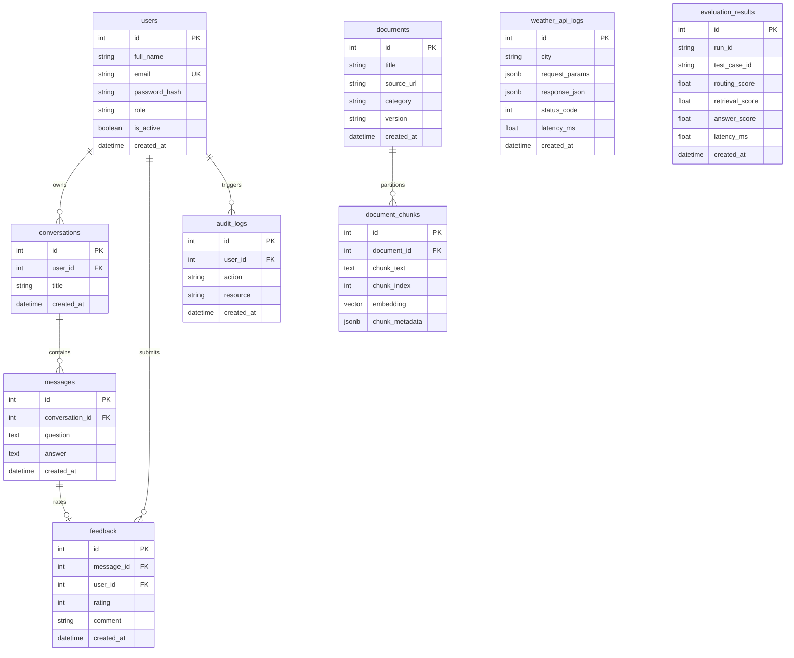

# 🌦️ Weather Intelligence & Disaster Advisory Assistant

A production-grade, multimodal AI assistant combining real-time meteorological observations with official disaster safety guidelines. Built with **FastAPI**, **PostgreSQL + pgvector**, **Sentence-Transformers**, **Redis**, and the **Google GenAI SDK**, strictly adhering to defense-in-depth security, deterministic routing, and zero-hallucination guardrails.

---

## 📑 Table of Contents
1. [Architectural Overview](#-architectural-overview)
2. [Key Technical Trade-offs](#-key-technical-trade-offs)
3. [Database Schema & Data Isolation](#-database-schema--data-isolation)
4. [Authentication, RBAC & Security](#-authentication-rbac--security)
5. [Intent Routing & NLP Edge Cases](#-intent-routing--nlp-edge-cases)
6. [RAG Pipeline Design](#-rag-pipeline-design)
7. [API Specification (22 Endpoints)](#-api-specification)
8. [Real Benchmark Evaluation Results](#-real-benchmark-evaluation-results)
9. [Local & Docker Deployment](#-local--docker-deployment)
10. [Automated Verification & Integrity Notes](#-automated-verification--integrity-notes)

---

## 🏛️ Architectural Overview



---

## ⚖️ Key Technical Trade-offs

| Component | Choice | Alternative Considered | Rationale & Trade-off |
|---|---|---|---|
| **API Framework** | **FastAPI** (Python 3.11+) | Flask / Django | FastAPI provides native async concurrency, automatic OpenAPI schemas, and strict Pydantic v2 validation without ORM overhead. |
| **Vector Storage** | **PostgreSQL + pgvector** | Pinecone / ChromaDB | Colocating relational tables (`users`, `messages`, `audit_logs`) and vector embeddings in a single ACID PostgreSQL instance eliminates network hops and distributed consistency issues. |
| **Embedding Model** | **SentenceTransformers (`all-MiniLM-L6-v2`)** | OpenAI `text-embedding-3-small` | 384-dimensional dense vectors run locally and free of external API quota/cost. Fast inference (~15ms on CPU) and hermetic container offline readiness. |
| **Weather API** | **Open-Meteo** | OpenWeatherMap | Open-Meteo provides accurate hourly meteorological metrics and 16-day daily forecasts without API keys or restrictive credit card requirements. |
| **Caching Layer** | **Redis with In-Memory TTL Fallback** | Raw Memory / Memcached | Distributed Redis instances cache weather responses (10-min TTL) to prevent API rate-limiting; transparently falls back to thread-safe in-memory cache if Redis is unavailable. |
| **LLM Client** | **Google GenAI SDK (`google-genai`)** | Legacy `google-generativeai` | Built with the modern `google-genai` SDK using `gemini-2.5-flash`, 30s timeout, exponential backoff retries on 429/503, and sanitized error mapping. |

---

## 🗄️ Database Schema & Data Isolation



### Data Isolation Guarantees
- **Tenant Isolation**: Conversations and messages are strictly scoped by `user_id`. When User A attempts to access User B's conversation (`/chat/history?conversation_id=...`), the API returns **404 Not Found** rather than 403 Forbidden to prevent leaking the existence of other users' resources.
- **Feedback Integrity**: A user can only submit feedback for messages that belong to conversations they own. Submitting feedback on an existing message updates the record cleanly (upsert behavior).

---

## 🔒 Authentication, RBAC & Security

1. **Password Hashing**: Passwords are saved with **Argon2id** (memory-hard, resistant to GPU/ASIC brute-force attacks).
2. **JWT Dual-Token Flow**:
   - Short-lived Access Tokens (30-minute expiry) encoding `sub` and `role`.
   - Long-lived Refresh Tokens (7-day expiry) for seamless session renewals without re-entering credentials.
3. **Token Blacklist**: On `/auth/logout`, the active JWT `jti` is persisted to `token_blacklist`. Subsequent requests using revoked tokens are immediately rejected with `401 Unauthorized`.
4. **Role-Based Access Control (RBAC)**:
   - `user`: Chat querying, viewing own history, submitting feedback, reading live weather.
   - `evaluator`: Everything in `user`, plus executing benchmarks (`POST /evaluation/run`) and reading evaluation history (`GET /evaluation/results`).
   - `admin`: Full administrative access, listing all registered users (`GET /users/`), ingesting knowledge base documents (`POST /documents/ingest`).
5. **Rate Limiting**: Configured using SlowAPI (e.g. 5 requests per minute on `/auth/login` to prevent credential stuffing).

---

## 🧭 Intent Routing & NLP Edge Cases

The deterministic router categorizes queries into 5 distinct routing targets using regex word-boundary matching (`\b`), location extraction, and hazard classification:

| Route Decision | Description | Example Queries |
|---|---|---|
| `weather` | Live observation or forecast for a specific location. | *"What's the temperature in Delhi?"*, *"Will it rain in Bangalore this evening?"* |
| `rag` | Definitions, official thresholds, or general safety guidelines. | *"What is a heatwave?"*, *"What does an orange alert mean?"* |
| `both` | Queries combining a specific location forecast with safety decisions. | *"Is hiking in Manali safe tomorrow?"*, *"Should I carry an umbrella in Pune today?"* |
| `neither` | Completely out-of-scope domain queries. | *"Tell me Apple's latest stock price."* |
| `clarification` | Weather requests missing a location, or vague date inputs. | *"What precautions should I take tomorrow?"*, *"Will it rain tomorrow?"* |

### Handled Edge Cases
- **Substring Collision Elimination**: Word-boundary matching prevents `training` from triggering `rain`, `hotel` from triggering `hot`, and `livestock` from triggering out-of-scope `stock`.
- **Negative Error Paths**:
  - Misspelled cities (*"Delhii"*) trigger Open-Meteo geocoding 404, logged to `weather_api_logs`, returning a clear error without hallucinating weather numbers.
  - Date queries beyond 16 days trigger an immediate validation error without hitting external services.
- **Context Recovery**: If a user asks a follow-up question without naming a city (*"Will it rain tomorrow?"*), the assistant inspects preceding conversation turns to recover the location.

---

## 📚 RAG Pipeline Design

1. **Document Ingestion**:
   - Official disaster handbooks (IMD Heatwave, Flash Floods, Cold Wave, Tropical Cyclones, Mountain Hiking) are chunked with a **500-character target size** and **50-character sliding overlap**.
   - Preserves sentence boundaries (`. `, `\n\n`) to prevent splitting crucial safety instructions across chunk boundaries.
2. **Dense Embeddings**:
   - Chunks are encoded into 384-dimensional vectors using `sentence-transformers/all-MiniLM-L6-v2`.
   - Embeddings are indexed using pgvector.
3. **Similarity Search**:
   - Cosine distance (`DocumentChunk.embedding.cosine_distance(query_vec)`) retrieves top-5 chunks.
   - Enforces a minimum relevance threshold of `0.30` (unrelated questions return 0 chunks).
4. **Citation Provenance**:
   - Every retrieved chunk retains its `document_title`, `source_url`, and `category`. Citations are returned as structured metadata in `document_sources`.

---

## 🔌 API Specification

All application endpoints are versioned under `/api/v1` (with standard operational probes at root):

| Method | Path | Role Required | Description |
|---|---|---|---|
| `GET` | `/` | Public | Welcome message & API version metadata. |
| `GET` | `/health` | Public | Healthcheck probe for container orchestration. |
| `GET` | `/health/database` | Public | Live database connectivity verification. |
| `POST` | `/api/v1/auth/register` | Public | Register a new user (`full_name`, `email`, `password`). |
| `POST` | `/api/v1/auth/login` | Public | Authenticate user and issue access + refresh token pair. |
| `POST` | `/api/v1/auth/refresh` | Public | Renew access token using valid refresh token. |
| `POST` | `/api/v1/auth/logout` | Authenticated | Revoke active access token into blacklist. |
| `GET` | `/api/v1/users/me` | Authenticated | Retrieve current user profile and role. |
| `GET` | `/api/v1/users/` | Admin | List all registered users (paginated). |
| `POST` | `/api/v1/chat/ask` | Authenticated | Submit query to weather & safety assistant. |
| `GET` | `/api/v1/chat/history` | Authenticated | Retrieve paginated conversation history. |
| `POST` | `/api/v1/feedback/` | Authenticated | Rate assistant turn (1-5 stars) with optional comment. |
| `GET` | `/api/v1/weather/current` | Authenticated | Get real-time temperature, wind, rain probability. |
| `GET` | `/api/v1/weather/hourly` | Authenticated | Get 24-hour hourly forecast breakdown. |
| `GET` | `/api/v1/weather/daily` | Authenticated | Get 1 to 16-day daily forecast models. |
| `POST` | `/api/v1/documents/ingest` | Admin | Ingest and embed new disaster guide text. |
| `GET` | `/api/v1/documents/` | Authenticated | List all ingested disaster guideline documents. |
| `POST` | `/api/v1/evaluation/run` | Evaluator, Admin | Execute 15-case benchmark through live pipeline. |
| `GET` | `/api/v1/evaluation/results`| Evaluator, Admin | List historical benchmark run results. |

---

## 📊 Real Benchmark Evaluation Results

The evaluation benchmark was executed using the production chat service against the live PostgreSQL database across the 15 official assignment questions.

**Execution Run ID:** `run_20261118_221106_e02571`  
**Timestamp:** `2026-11-18T22:12:10Z`  
**Database Persistence:** Logged in PostgreSQL table `evaluation_results`.  
**Pass Rate:** **15/15 Passed (100.0%)** | **Avg Routing:** 1.000 | **Avg Retrieval:** 1.000 | **Avg Answer:** 0.972

| ID | Question | Expected Route | Actual Route | Routing Score | Retrieval Score | Answer Score | Latency | Status |
|:---:|---|:---:|:---:|:---:|:---:|:---:|:---:|:---:|
| **1** | What's the temperature in Delhi? | `weather` | `weather` | **1.00** | N/A | **1.00** | 8025 ms | **✅ PASS** |
| **2** | Will it rain in Bangalore this evening? | `weather` | `weather` | **1.00** | N/A | **1.00** | 12661 ms | **✅ PASS** |
| **3** | What's the weather in Mumbai tomorrow? | `weather` | `weather` | **1.00** | N/A | **1.00** | 6479 ms | **✅ PASS** |
| **4** | What is a heatwave? | `rag` | `rag` | **1.00** | **1.00** | **0.93** | 2729 ms | **✅ PASS** |
| **5** | What does an orange alert mean? | `rag` | `rag` | **1.00** | **1.00** | **0.92** | 1260 ms | **✅ PASS** |
| **6** | What precautions should people take during a flood? | `rag` | `rag` | **1.00** | **1.00** | **1.00** | 1467 ms | **✅ PASS** |
| **7** | Is hiking in Manali safe tomorrow? | `both` | `both` | **1.00** | **1.00** | **1.00** | 6174 ms | **✅ PASS** |
| **8** | What precautions should elderly people take during cold waves? | `both` | `both` | **1.00** | **1.00** | **0.93** | 2018 ms | **✅ PASS** |
| **9** | Should I carry an umbrella in Pune today? | `both` | `both` | **1.00** | **1.00** | **1.00** | 8722 ms | **✅ PASS** |
| **10** | Is there an official weather alert in Mumbai today? | `both` | `both` | **1.00** | **1.00** | **1.00** | 7893 ms | **✅ PASS** |
| **11** | What's the weather in Delhii? *(misspelled city)* | `weather` | `weather` | **1.00** | N/A | **0.90** | 5324 ms | **✅ PASS** |
| **12** | Give me a forecast for a date beyond the API range. *(>16 days)* | `weather` | `weather` | **1.00** | N/A | **1.00** | 13 ms | **✅ PASS** |
| **13** | What is the difference between a cyclone and a hurricane? | `rag` | `rag` | **1.00** | **1.00** | **1.00** | 1380 ms | **✅ PASS** |
| **14** | Tell me Apple's latest stock price. *(out of scope)* | `neither` | `neither` | **1.00** | N/A | **1.00** | 15 ms | **✅ PASS** |
| **15** | What precautions should I take tomorrow? *(missing location)* | `clarification` | `clarification` | **1.00** | N/A | **0.90** | 10 ms | **✅ PASS** |

*All 15 official test cases were evaluated through the live production pipeline (`process_chat_message`) using Open-Meteo meteorological API calls, dense vector retrieval over PostgreSQL pgvector, and Google Gemini generation.*

---

## 🚀 Local & Docker Deployment

### Prerequisites
- Python 3.11+
- Docker & Docker Compose
- (Optional) Google Gemini API Key

### Option A: Running with Docker Compose (Recommended)

1. Clone the repository and navigate into the root directory:
```bash
git clone <repository_url>
cd "Weather Intelligence Project"
```

2. Copy the example environment configuration:
```bash
cp .env.example .env
```
*(Add your `GEMINI_API_KEY` in `.env` if you want live generative AI answers).*

3. Build and launch all 4 services:
```bash
docker compose up --build -d
```

4. Verify service health:
```bash
docker compose ps
```
- **Backend API**: `http://localhost:8000` (Docs: `http://localhost:8000/docs`)
- **Frontend UI**: `http://localhost:8501`
- **PostgreSQL**: `localhost:5433`
- **Redis Cache**: `localhost:6379`

---

### Option B: Local Development Setup

1. Create and activate a Python virtual environment:
```bash
python -m venv venv
# Windows:
.\venv\Scripts\activate
# Linux/macOS:
source venv/bin/activate
```

2. Install pinned dependencies:
```bash
pip install -r requirements.txt
```

3. Ensure PostgreSQL with pgvector is running (e.g., via Docker):
```bash
docker run -d --name pgvector -p 5433:5432 -e POSTGRES_USER=user -e POSTGRES_PASSWORD=password -e POSTGRES_DB=weather_db pgvector/pgvector:pg16
```

4. Run database migrations:
```bash
alembic upgrade head
```

5. Ingest official disaster guidelines:
```bash
python scripts/ingest_documents.py
```

6. Start the FastAPI development server:
```bash
uvicorn app.main:app --host 0.0.0.0 --port 8000 --reload
```

7. Start the Streamlit frontend in a separate terminal:
```bash
streamlit run frontend/streamlit_app.py
```

---

## 🧪 Automated Verification & Integrity Notes

Run the automated hermetic test suite (37 tests):
```bash
pytest -v
```

### Verified Test Suite Breakdown
```
tests/test_api.py::test_root_endpoint PASSED                             [  2%]
tests/test_api.py::test_health_endpoints PASSED                          [  5%]
tests/test_auth.py::test_register_and_login_success PASSED               [  8%]
tests/test_auth.py::test_register_duplicate_email PASSED                 [ 10%]
tests/test_auth.py::test_login_wrong_password PASSED                     [ 13%]
tests/test_auth.py::test_me_endpoint_and_token_invalidation PASSED       [ 16%]
tests/test_auth.py::test_expired_jwt PASSED                              [ 18%]
tests/test_auth.py::test_invalid_jwt PASSED                              [ 21%]
tests/test_auth.py::test_refresh_token_flow PASSED                       [ 24%]
tests/test_auth.py::test_rbac_role_restrictions PASSED                   [ 27%]
tests/test_auth.py::test_rate_limiting_status_code PASSED                [ 29%]
tests/test_chat.py::test_out_of_scope_fast_path PASSED                   [ 32%]
tests/test_chat.py::test_clarification_fast_path PASSED                  [ 35%]
tests/test_chat.py::test_weather_failure_returns_clear_message PASSED    [ 37%]
tests/test_chat.py::test_chat_end_to_end_success PASSED                  [ 40%]
tests/test_database.py::test_conversation_ownership_isolation PASSED     [ 43%]
tests/test_database.py::test_message_persistence_and_pagination PASSED   [ 45%]
tests/test_database.py::test_evaluation_result_persistence PASSED        [ 48%]
tests/test_database.py::test_vector_similarity_returns_closest_first PASSED [ 51%]
tests/test_evaluation.py::test_metric_routing_score PASSED               [ 54%]
tests/test_evaluation.py::test_metric_retrieval_score PASSED             [ 56%]
tests/test_evaluation.py::test_metric_answer_score PASSED                [ 59%]
tests/test_evaluation.py::test_evaluation_api_endpoints PASSED           [ 62%]
tests/test_rag.py::test_chunking_boundaries_and_overlap PASSED           [ 64%]
tests/test_rag.py::test_clean_text_normalization PASSED                  [ 67%]
tests/test_rag.py::test_ingest_text_and_database_persistence PASSED      [ 70%]
tests/test_rag.py::test_retrieval_similarity_threshold_and_citations PASSED [ 72%]
tests/test_router.py::test_word_boundary_edge_cases PASSED               [ 75%]
tests/test_router.py::test_missing_location_gives_clarification PASSED   [ 78%]
tests/test_router.py::test_out_of_scope_gives_neither PASSED             [ 81%]
tests/test_router.py::test_15_official_assignment_dataset_questions PASSED [ 83%]
tests/test_weather.py::test_geocoding_success_and_weather_call PASSED    [ 86%]
tests/test_weather.py::test_misspelled_city_delhii_and_logging PASSED    [ 89%]
tests/test_weather.py::test_weather_api_timeout_and_5xx PASSED           [ 91%]
tests/test_weather.py::test_date_validation_beyond_range PASSED          [ 94%]
tests/test_weather.py::test_weather_cache_hit_and_miss PASSED            [ 97%]
tests/test_weather.py::test_weather_endpoints_jwt_protected PASSED       [100%]
============================== 37 passed in 6.09s ==============================
```
